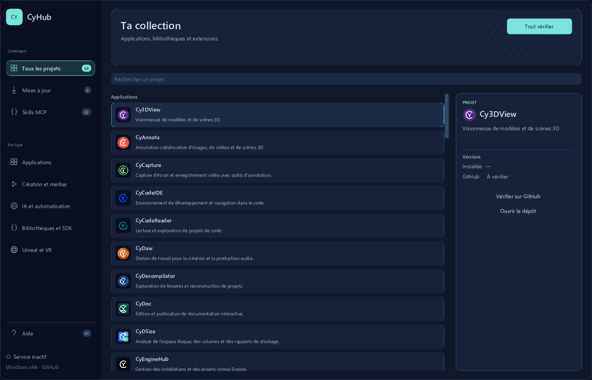

<table width="100%">
  <tr>
    <td width="300" align="left" valign="top">
      <a href="Documentation/Documentation.html#/fr/overview">Manuel hors ligne</a><br>
      <a href="https://github.com/MrMybal/CyHub">Dépôt GitHub</a><br><br>
      <sub>README</sub><br>
      <a href="README.md">English</a> · <a href="README.fr.md">Français</a>
    </td>
    <td width="400" align="center" valign="middle"><strong>CyHub</strong></td>
    <td width="300" align="right" valign="top">
      <p><a href="#licences">Licences des composants</a></p>
      <p><sub>Version</sub><br><a href="VERSION.fr.md"><strong>0.1.0</strong></a><br><strong>EN DÉVELOPPEMENT</strong></p>
      <p><sub>Windows x64 · compilation depuis les sources</sub></p>
    </td>
  </tr>
</table>

<h1 align="center">CyHub</h1>

CyHub rassemble les applications, bibliothèques, SDK et extensions de l’écosystème Cy dans un catalogue de bureau. Recherche un projet, consulte sa dernière publication GitHub et ouvre son guide MCP depuis la même fiche.

> **EN DÉVELOPPEMENT · 0.1.0**
>
> Le bureau et le service de mise à jour ciblent Windows x64. Voir les [notes de version et limites](VERSION.fr.md).

[](assets/screenshots/catalogue.png)

## Le catalogue CyHub

- **59 projets** regroupés par type, avec descriptions, icônes disponibles et liens vers les dépôts.
- **14 projets configurés pour l’installation gérée** par le service Windows. Le service vérifie le SHA-256 publié et reste actif après la fermeture de la fenêtre.
- **32 skills MCP** à lire ou copier dans CyHub. Le serveur stdio fondé sur CyMCPSDK expose aussi le catalogue, les vérifications de version et les guides en lecture seule.

---

## Installation

Après la compilation décrite ci-dessous, ouvre `CyHub.exe` dans le dossier `dist/CyHub`. Les binaires Windows utilisent le runtime Microsoft Visual C++ x64.

Pour activer l’installation gérée, ferme CyHub, ouvre PowerShell x64 en tant qu’administrateur et lance `Install-CyHub.ps1` depuis `dist/CyHub`. Ouvre ensuite `%ProgramFiles%\CyHub\CyHub.exe`. **Aide** et **F1** ouvrent le manuel local.

## Sources et compilation

Prépare Git, CMake 3.24+ et Visual Studio 2022 avec les outils C++ x64. Exécute ces commandes depuis la racine du dépôt.

```powershell
cmake -S . -B build/windows -G "Visual Studio 17 2022" -A x64
cmake --build build/windows --config Release --parallel
ctest --test-dir build/windows -C Release --output-on-failure
cmake --install build/windows --config Release --prefix dist/CyHub --component CyHub
```

Le même projet peut être compilé avec Ninja depuis **x64 Native Tools for VS 2022**. Utilise `-G Ninja -DCMAKE_BUILD_TYPE=Release` pour la configuration. CMake récupère les révisions épinglées de CyUI, CyMCPSDK, SDL3 et miniz. Les variables `FETCHCONTENT_SOURCE_DIR_CYUI`, `FETCHCONTENT_SOURCE_DIR_CYMCPSDK`, `FETCHCONTENT_SOURCE_DIR_SDL3` et `FETCHCONTENT_SOURCE_DIR_MINIZ` permettent d’utiliser des sources locales.

---

## Licences

Les composants intégrés conservent leurs licences. Le paquet distribue les notices dans `licenses/`, et le lecteur CyDoc fournit la sienne dans `Documentation/DocData/`.

| Composant | Licence | Utilisation |
| --- | --- | --- |
| [CyUI](https://github.com/MrMybal/CyUI) et [Dear ImGui](https://github.com/ocornut/imgui) | MIT | Interface et rendu des widgets. |
| [SDL3](https://github.com/libsdl-org/SDL) | zlib | Fenêtre, entrées et moteur de rendu. |
| [CyMCPSDK](https://github.com/MrMybal/CyMCPSDK), [nlohmann/json](https://github.com/nlohmann/json) et [cpp-httplib](https://github.com/yhirose/cpp-httplib) | MIT | Catalogue JSON, transport HTTPS et serveur MCP. |
| [miniz](https://github.com/richgel999/miniz) et [PicoSHA2](https://github.com/okdshin/PicoSHA2) | MIT | Extraction ZIP et vérification SHA-256 sous Windows. |
| [CyDoc](https://github.com/MrMybal/CyDoc) | MIT | Manuel HTML hors ligne et outillage de génération. |

## Références

- [Manuel CyHub en français](Documentation/Documentation.html#/fr/overview)
- [Notes de version](VERSION.fr.md)
- [Dépôt CyHub](https://github.com/MrMybal/CyHub)

<details>
<summary>AI Usage</summary>

[Guide pour agents](Documentation/DocAI.md) · [Skills des projets](skills/)

</details>
