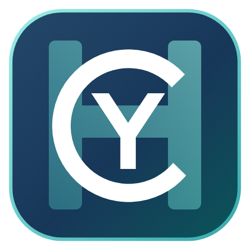

<table width="100%">
  <tr>
    <td width="300" align="left" valign="top">
      <a href="Documentation/Documentation.html#/fr/overview">Manuel hors ligne</a><br>
      <a href="https://github.com/MrMybal/CyHub">Dépôt GitHub</a><br><br>
      <sub>README</sub><br>
      <a href="README.md">English</a> · <a href="README.fr.md">Français</a>
    </td>
    <td width="400" align="center" valign="middle"></td>
    <td width="300" align="right" valign="top">
      <p><a href="LICENSE"><strong>GNU GPL v3</strong></a></p>
      <p><sub>Version</sub><br><a href="VERSION.fr.md"><strong>0.4.0</strong></a><br><strong>EN DÉVELOPPEMENT</strong></p>
      <p><a href="https://github.com/MrMybal/CyHub/releases"><strong>Préversion Windows x64</strong></a></p>
    </td>
  </tr>
</table>

<h1 align="center">CyHub</h1>

CyHub rassemble les applications, bibliothèques, SDK et extensions de l’écosystème Cy dans un catalogue de bureau. Recherche un projet, consulte sa dernière publication GitHub et ouvre son guide MCP depuis la même fiche.

> **EN DÉVELOPPEMENT · 0.4.0**
>
> La préversion Windows x64 inclut le bureau, le service de mise à jour, le serveur MCP et le manuel hors ligne. Voir les [notes de version et limites](VERSION.fr.md).

[](Documentation/DocData/assets/catalogue.png)

## Le catalogue CyHub

- **61 projets** regroupés par type, avec descriptions, icônes disponibles et liens vers les dépôts.
- Passe de la **Liste** aux **Cartes**. Les fiches affichent la description GitHub, le README, les images de vitrine disponibles et les notes de version.
- **Applications installées** détecte automatiquement les projets du catalogue sous Windows. **Mises à jour** compare les versions installées connues aux publications GitHub accessibles.
- Coche plusieurs paquets compatibles et clique sur **Installer la sélection** pour les ajouter à la file. Les plugins Unreal et VR ont leurs propres rubriques de téléchargement.
- **33 skills MCP** à lire ou copier dans CyHub. Le serveur stdio fondé sur CyMCPSDK expose aussi le catalogue, les vérifications de version et les guides en lecture seule.

### Applications recommandées

[CyMCPHub](https://github.com/MrMybal/CyMCPHub) regroupe les skills, serveurs MCP, outils CLI et SDK dans un même espace. Clique sur **Installer CyMCPHub** dans le catalogue ou la vue Skills MCP. La préversion Windows inclut CyMCPHub 0.3.0 et l’installe pour ton compte sans droits administrateur.

Ouvre CyMCPHub depuis la barre d’actions de CyHub pour charger la source MCP **CyHub**. Dans CyMCPHub, sélectionne ce connecteur et choisis **Skills → Collecter les skills du connecteur** pour ajouter les guides à sa bibliothèque. Pour le dépôt privé, lance CyHub avec un `GH_TOKEN` qui donne accès à ses publications. [Guide CyMCPHub](Documentation/Documentation.html#/fr/mcp/companion)

**CyModelHub** gère une bibliothèque locale de modèles IA. Les applications compatibles retrouvent et réutilisent les mêmes fichiers. Ouvre sa fiche depuis la barre d’actions pour accéder au dépôt et au guide MCP. CyHub propose l’installation pour ton compte Windows dès qu’une publication accessible contient une archive vérifiée `CyModelHub-<version>-windows-x64.zip`. [Guide CyModelHub](Documentation/Documentation.html#/fr/mcp/modelhub)

---

## Installation

Lance `CyHub-Setup-windows-x64.exe` pour une installation Windows par compte. Choisis l’installation pour tous les utilisateurs dans le dossier Program Files par défaut pour activer CyHub Updater. Tu peux aussi extraire et lancer le ZIP portable `CyHub-windows-x64.zip`. Les binaires Windows utilisent le [runtime Microsoft Visual C++ x64](https://learn.microsoft.com/cpp/windows/latest-supported-vc-redist).

CyHub démarre en anglais. **Settings → Language → Français** permet de changer de langue. Les **Paramètres** mémorisent aussi le dossier de téléchargement et le contrôle GitHub au démarrage. **Aide** et **F1** ouvrent le manuel local.

La version est affichée près du logo. **Mettre à jour CyHub** télécharge et vérifie l’installateur d’une publication GitHub plus récente, ouvre l’installation et ferme CyHub. Les publications privées nécessitent un `GH_TOKEN` avec accès en lecture. [Instructions de mise à jour](Documentation/Documentation.html#/fr/installation/upgrade)

## Sources et compilation

Prépare Git, CMake 3.24+ et Visual Studio 2022 avec les outils C++ x64. Exécute ces commandes depuis la racine du dépôt.

```powershell
cmake -S . -B build/windows -G "Visual Studio 17 2022" -A x64
cmake --build build/windows --config Release --parallel
ctest --test-dir build/windows -C Release --output-on-failure
cmake --install build/windows --config Release --prefix dist/CyHub --component CyHub
Compress-Archive -Path dist/CyHub -DestinationPath dist/CyHub-windows-x64.zip -Force
```

Le même projet peut être compilé avec Ninja depuis **x64 Native Tools for VS 2022**. Utilise `-G Ninja -DCMAKE_BUILD_TYPE=Release` pour la configuration. CMake récupère les révisions épinglées de CyUI, CyMCPSDK, SDL3 et miniz. Les variables `FETCHCONTENT_SOURCE_DIR_CYUI`, `FETCHCONTENT_SOURCE_DIR_CYMCPSDK`, `FETCHCONTENT_SOURCE_DIR_SDL3` et `FETCHCONTENT_SOURCE_DIR_MINIZ` permettent d’utiliser des sources locales.

Pour inclure CyMCPHub et permettre son installation hors ligne, passe `-DCYHUB_CYMCPHUB_PACKAGE=chemin/vers/CyMCPHub-0.3.0-windows-x64.zip` à la configuration CMake. Utilise l’archive portable qui contient `CyMCPHub.exe` et `CyMCPHubMcp.exe` à sa racine.

---

## Licences

CyHub est sous [licence publique générale GNU version 3](LICENSE) (`GPL-3.0-only`).

Les composants intégrés conservent leurs licences. Le paquet distribue les notices dans `licenses/`, et le lecteur CyDoc fournit la sienne dans `Documentation/DocData/`.

| Composant | Licence | Utilisation |
| --- | --- | --- |
| [CyUI](https://github.com/MrMybal/CyUI) et [Dear ImGui](https://github.com/ocornut/imgui) | MIT | Interface et rendu des widgets. |
| [SDL3](https://github.com/libsdl-org/SDL) | zlib | Fenêtre, entrées et moteur de rendu. |
| [CyMCPSDK](https://github.com/MrMybal/CyMCPSDK), [nlohmann/json](https://github.com/nlohmann/json) et [cpp-httplib](https://github.com/yhirose/cpp-httplib) | MIT | Catalogue JSON, transport HTTPS et serveur MCP. |
| [miniz](https://github.com/richgel999/miniz) et [PicoSHA2](https://github.com/okdshin/PicoSHA2) | MIT | Extraction ZIP et vérification SHA-256 sous Windows. |
| [CyDoc](https://github.com/MrMybal/CyDoc) | MIT | Manuel HTML hors ligne et outillage de génération. |
| [CyMCPHub](https://github.com/MrMybal/CyMCPHub) | GPL-3.0-only | Application complémentaire. Son archive source est disponible avec la préversion Windows. |

## Références

- [Manuel CyHub en français](Documentation/Documentation.html#/fr/overview)
- [Notes de version](VERSION.fr.md)
- [Dépôt CyHub](https://github.com/MrMybal/CyHub)

<details>
<summary>AI Usage</summary>

[Guide pour agents](Documentation/DocAI.md) · [Skills des projets](skills/)

</details>
