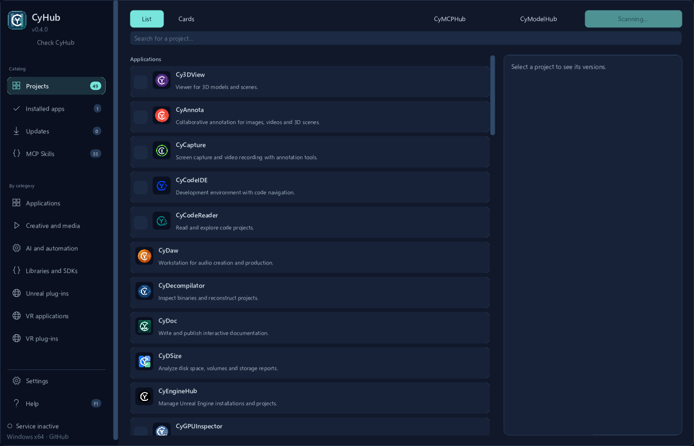

<table width="100%">
  <tr>
    <td width="300" align="left" valign="top">
      <a href="Documentation/Documentation.html#/en/overview">Offline manual</a><br>
      <a href="https://github.com/MrMybal/CyHub">GitHub repository</a><br><br>
      <sub>README</sub><br>
      <a href="README.md">English</a> · <a href="README.fr.md">Français</a>
    </td>
    <td width="400" align="center" valign="middle"><strong>CyHub</strong></td>
    <td width="300" align="right" valign="top">
      <p><a href="LICENSE"><strong>GNU GPL v3</strong></a></p>
      <p><sub>Version</sub><br><a href="VERSION.md"><strong>0.1.0</strong></a><br><strong>IN DEVELOPMENT</strong></p>
      <p><a href="https://github.com/MrMybal/CyHub/releases/tag/v0.1.0"><strong>Windows x64 preview</strong></a></p>
    </td>
  </tr>
</table>

<h1 align="center">CyHub</h1>

CyHub brings the Cy ecosystem's applications, libraries, SDKs and extensions into one desktop catalog. Find a project, check its latest GitHub release and open its MCP guide from the same project panel.

> **IN DEVELOPMENT · 0.1.0**
>
> The Windows x64 preview includes the desktop app, update service, MCP server and offline manual. See the [version notes and limitations](VERSION.md).

[](Documentation/DocData/assets/catalog.png)

## The CyHub catalog

- **59 projects** organized by type, with descriptions, available artwork and repository links.
- **14 projects configured for managed installation** through the Windows service. The service verifies the published SHA-256 and continues working after the window closes.
- **32 MCP skills** to read or copy in CyHub. The CyMCPSDK stdio server also exposes the catalog, release checks and guides through read-only tools.

---

## Installation

Download `CyHub-windows-x64.zip` from the [Windows x64 preview](https://github.com/MrMybal/CyHub/releases/tag/v0.1.0) and extract the complete archive. Open `CyHub.exe` in the extracted folder. The Windows binaries use the [Microsoft Visual C++ x64 runtime](https://learn.microsoft.com/cpp/windows/latest-supported-vc-redist).

CyHub starts in English. Use **Language** in the sidebar to switch to French. CyHub remembers your choice.

To enable managed installs, close CyHub, open PowerShell x64 as administrator and run `Install-CyHub.ps1` from the extracted folder. Then launch `%ProgramFiles%\CyHub\CyHub.exe`. Use **Help** or press **F1** to open the local manual in the selected language.

To update CyHub itself, extract the new package into a fresh folder. If you use the Windows service, close CyHub and rerun the installer from that folder. [Update instructions](Documentation/Documentation.html#/en/installation/upgrade)

## Source and build

Use Git, CMake 3.24 or later, and Visual Studio 2022 with the x64 C++ tools. Run these commands from the repository root.

```powershell
cmake -S . -B build/windows -G "Visual Studio 17 2022" -A x64
cmake --build build/windows --config Release --parallel
ctest --test-dir build/windows -C Release --output-on-failure
cmake --install build/windows --config Release --prefix dist/CyHub --component CyHub
Compress-Archive -Path dist/CyHub -DestinationPath dist/CyHub-windows-x64.zip -Force
```

You can also build with Ninja from **x64 Native Tools for VS 2022**. Configure with `-G Ninja -DCMAKE_BUILD_TYPE=Release`. CMake fetches pinned revisions of CyUI, CyMCPSDK, SDL3 and miniz. Use `FETCHCONTENT_SOURCE_DIR_CYUI`, `FETCHCONTENT_SOURCE_DIR_CYMCPSDK`, `FETCHCONTENT_SOURCE_DIR_SDL3` or `FETCHCONTENT_SOURCE_DIR_MINIZ` to use existing checkouts.

---

## Licenses

CyHub is licensed under the [GNU General Public License version 3](LICENSE) (`GPL-3.0-only`).

Bundled components retain their licenses. The package includes their notices in `licenses/`, and the CyDoc reader includes its notice in `Documentation/DocData/`.

| Component | License | Use |
| --- | --- | --- |
| [CyUI](https://github.com/MrMybal/CyUI) and [Dear ImGui](https://github.com/ocornut/imgui) | MIT | Interface and widget rendering. |
| [SDL3](https://github.com/libsdl-org/SDL) | zlib | Windowing, input and renderer backend. |
| [CyMCPSDK](https://github.com/MrMybal/CyMCPSDK), [nlohmann/json](https://github.com/nlohmann/json) and [cpp-httplib](https://github.com/yhirose/cpp-httplib) | MIT | JSON catalog, HTTPS transport and MCP server. |
| [miniz](https://github.com/richgel999/miniz) and [PicoSHA2](https://github.com/okdshin/PicoSHA2) | MIT | ZIP extraction and SHA-256 verification on Windows. |
| [CyDoc](https://github.com/MrMybal/CyDoc) | MIT | Offline HTML manual and generation tools. |

## References

- [English CyHub manual](Documentation/Documentation.html#/en/overview)
- [Version notes](VERSION.md)
- [CyHub repository](https://github.com/MrMybal/CyHub)

<details>
<summary>AI Usage</summary>

[Agent guide](Documentation/DocAI.md) · [Project skills](skills/)

</details>
